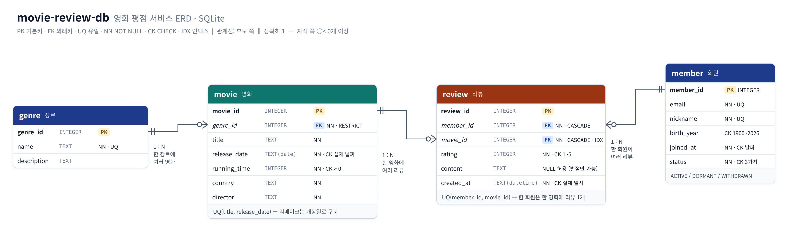
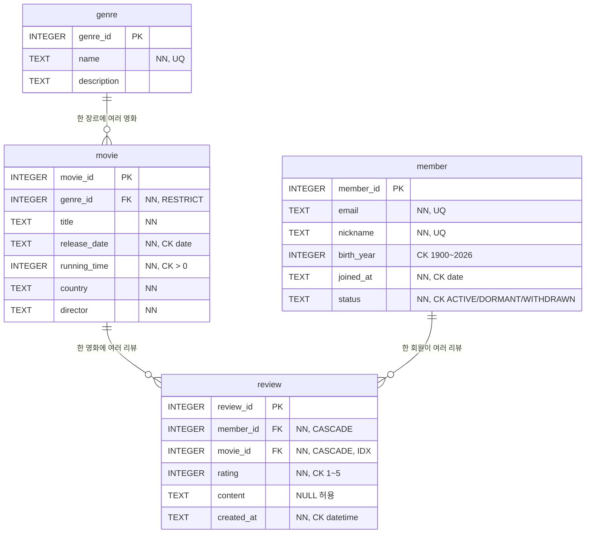

# movie-review-db

> Relational database for a movie rating service with members, movies, genres, and reviews, including schema design, sample data, and 15 SQL queries covering joins, aggregation, subqueries, and indexing
> 회원, 영화, 장르, 리뷰를 다루는 영화 평점 서비스 DB로 스키마 설계, 샘플 데이터, 조인·집계·서브쿼리·인덱스를 포함한 SQL 쿼리 15개를 정리한 프로젝트


백엔드 프레임워크 없이 **데이터 모델링 → 데이터 입력 → 요구사항을 SQL 로 해결** 하는 전체 흐름을 SQLite 로 구현했습니다.
모든 실행 결과는 손으로 붙여넣지 않고 스크립트가 실제로 실행해 [`results/`](results/README.md) 에 기록하며, CI 가 SQL 과 결과가 일치하는지 매번 검사합니다.



## 목차

- [빠른 시작](#빠른-시작)
- [제출물 구성](#제출물-구성)
- [스키마](#스키마)
- [쿼리 목록](#쿼리-목록)
- [요구사항 구현 매핑](#요구사항-구현-매핑)
- [선택(보너스) 과제 구현 내역](#선택보너스-과제-구현-내역)
- [프로젝트 구조](#프로젝트-구조)
- [문서](#문서)

## 빠른 시작

### 방법 1. Python 스크립트 (추천, 설치 불필요)

Python 3.10 이상에 포함된 `sqlite3` 모듈만 사용합니다. 기준 버전은 3.14(`.python-version`)이고, [uv](https://docs.astral.sh/uv/) 를 쓰면 `uv run python ...` 으로 같은 버전에서 실행됩니다.

```bash
git clone https://github.com/maebsy/movie-review-db.git
cd movie-review-db
python scripts/run_all.py
```

```text
[완료] movie_review.db 생성, results/ 에 36개 파일 기록
```

`movie_review.db`(샘플 데이터가 들어간 DB)가 생기고, 모든 쿼리의 결과가 `results/` 에 다시 기록됩니다.

### 방법 2. DB Browser for SQLite / DBeaver

1. 새 DB 파일을 만들거나 방법 1 로 만든 `movie_review.db` 를 엽니다.
2. SQL 편집기에서 `sql/01_schema.sql` → `sql/02_seed.sql` → `sql/03_queries.sql` 순서로 실행합니다.
3. **주의**: SQLite 는 외래키 검사가 기본으로 꺼져 있습니다. 각 파일 첫 줄의 `PRAGMA foreign_keys = ON;` 이 실행되는지 확인하세요(DBeaver 는 연결 설정의 `foreign_keys` 옵션도 켜 두면 좋습니다).

### 방법 3. sqlite3 CLI

```bash
sqlite3 movie_review.db < sql/01_schema.sql
sqlite3 movie_review.db < sql/02_seed.sql
sqlite3 -box movie_review.db < sql/03_queries.sql
```

## 제출물 구성

| 제출물 | 파일 | 내용 |
| --- | --- | --- |
| 스키마 생성 SQL | [`sql/01_schema.sql`](sql/01_schema.sql) | 4개 테이블, PK · FK 3개 · NOT NULL · UNIQUE · CHECK, 실행 순서대로 정리 |
| 샘플 데이터 INSERT SQL | [`sql/02_seed.sql`](sql/02_seed.sql) | genre 10 · member 15 · movie 22 · review 78 행 (부모 → 자식 순서, 한 트랜잭션) |
| 쿼리 15개 SQL | [`sql/03_queries.sql`](sql/03_queries.sql) | 17개, 쿼리마다 "무엇을 확인하는지" 한 줄 설명 |
| 실행 결과 폴더 | [`results/`](results/README.md) | 쿼리별 텍스트 결과 + 전체 결과 표 모음 |
| (선택) ERD | [`docs/erd.png`](docs/erd.png) | 원본: [`docs/erd.html`](docs/erd.html) |

## 스키마



| 설계 포인트 | 내용 |
| --- | --- |
| 테이블 분리 | 한 가지 대상은 한 테이블에 한 번만 저장 → 중복·수정·삽입·삭제 이상 방지 |
| 1:N 관계 3개 | `genre → movie`, `member → review`, `movie → review`. `review` 는 회원과 영화의 N:M 을 잇는 연결 테이블 |
| 삭제 정책 | 장르는 `RESTRICT`(쓰이는 장르는 못 지움), 리뷰는 회원·영화 삭제 시 `CASCADE` |
| 중복 방지 | `UNIQUE(member_id, movie_id)` — 한 회원은 한 영화에 리뷰 1개 |
| 날짜 | SQLite 에는 DATE 타입이 없어 ISO-8601 `TEXT` + `CHECK (date(x, '+0 days') IS x)` 로 실제 날짜만 허용 |
| 인덱스 | `review(movie_id)` — 영화별 조회·집계에 가장 많이 쓰이고, FK 컬럼은 자동 인덱스가 없음 |

설계 이유는 [`docs/design.md`](docs/design.md) 에 자세히 정리했습니다.

## 쿼리 목록

| ID | 분류 | 내용 | 결과 |
| --- | --- | --- | --- |
| Q01 | 기본 조회 | 2020년 이후 개봉작을 최신 개봉순으로 | [Q01](results/Q01.txt) |
| Q02 | 기본 조회 | 별점 5점 리뷰 중 최근 5개 (`LIMIT`) | [Q02](results/Q02.txt) |
| Q03 | 기본 조회 | 러닝타임 150분 이상 영화 | [Q03](results/Q03.txt) |
| Q04 | 기본 조회 | 제목에 '의' 가 들어간 영화 (`LIKE`) | [Q04](results/Q04.txt) |
| Q05 | 조인 (INNER) | 최근 리뷰 10개 + 회원 닉네임 + 영화 제목 (3개 테이블) | [Q05](results/Q05.txt) |
| Q06 | 조인 (INNER) | 장르 이름과 함께 영화 목록 | [Q06](results/Q06.txt) |
| Q07 | 조인 (LEFT) | 리뷰를 한 번도 쓰지 않은 회원 | [Q07](results/Q07.txt) |
| Q08 | 조인 (LEFT) | 영화별 리뷰 수 (리뷰 없는 영화는 0) | [Q08](results/Q08.txt) |
| Q09 | 집계 (랭킹) | 평균 별점 TOP 5 (리뷰 3개 이상, `HAVING`) | [Q09](results/Q09.txt) |
| Q10 | 집계 | 장르별 영화 수 · 리뷰 수 · 평균 별점 | [Q10](results/Q10.txt) |
| Q11 | 집계 | 회원별 리뷰 수 · 평균 준 별점 · 총 관람 시간(`SUM`) | [Q11](results/Q11.txt) |
| Q12 | 집계 | 월별 리뷰 수와 평균 별점 추이 | [Q12](results/Q12.txt) |
| Q13 | 서브쿼리 | 전체 평균보다 평균 별점이 높은 영화 | [Q13](results/Q13.txt) |
| Q14 | 서브쿼리 (상관) | 장르마다 평균 별점 1위 영화 (CTE + 상관 서브쿼리) | [Q14](results/Q14.txt) |
| Q15 | 수정 (UPDATE) | 6월 이후 리뷰가 없는 ACTIVE 회원을 휴면 전환 | [Q15](results/Q15.txt) |
| Q16 | 삭제 (DELETE) | 탈퇴 회원 삭제 → 리뷰 CASCADE 삭제 확인 | [Q16](results/Q16.txt) |
| Q17 | 인덱스 | `CREATE INDEX idx_review_movie_id` + 생성 전/후 실행 계획 | [Q17](results/Q17.txt) |

결과 예시 ([`results/Q09.txt`](results/Q09.txt))

```text
title        | avg_rating | review_count
-------------+------------+-------------
서울의 봄    |       4.75 |            4
기생충       |       4.71 |            7
인터스텔라   |       4.67 |            6
듄: 파트 2   |       4.67 |            3
너의 이름은. |        4.5 |            4
(5 rows)
```

인덱스 효과 ([`results/Q17.txt`](results/Q17.txt))

```text
생성 전   `--SCAN review
생성 후   `--SEARCH review USING INDEX idx_review_movie_id (movie_id=?)
```

DB 전용 문법(`PRAGMA`, `strftime`, `EXPLAIN QUERY PLAN`, `date()` CHECK)은 쿼리 옆에 `[SQLite 전용]` 주석과 MySQL/PostgreSQL 대응 문법을 적었습니다.

## 요구사항 구현 매핑

| 요구사항 | 구현 | 자동 검증 |
| --- | --- | --- |
| 최소 4개 테이블, 각 PK | genre · member · movie · review | `test_at_least_four_tables_each_with_primary_key` |
| FK 1:N 2개 이상, 없는 값 참조 차단 | FK 3개 + `PRAGMA foreign_keys = ON` | `test_foreign_keys_block_missing_parent` |
| NOT NULL 1개 이상, UNIQUE 1개 이상 | NOT NULL 다수, UNIQUE 5개 | `test_not_null_and_unique_constraints_exist` |
| 테이블당 10행 이상, 관계가 실제로 연결된 데이터 | 10 / 15 / 22 / 78행, FK 위반 0건 | `test_every_table_has_at_least_ten_rows` |
| 기본 4 · 조인 4(INNER 2, LEFT 1) · 집계 3 · 서브쿼리 1 · 수정/삭제 2 · 인덱스 1 | 4 · 4(INNER 2, LEFT 2) · 4 · 2 · 2 · 1 = 17개 | `test_category_minimums` |
| 쿼리마다 한 줄 설명 + 실행 결과 | `-- @Qnn \| 분류 \| 설명` + `results/` | `run_all.py --check` |
| 인덱스 적용 이유 1줄 | Q17 주석 + 실행 계획 비교 | |
| DB 전용 문법 주석 | `[SQLite 전용]` 표기 | |
| View · 프로시저 · 트리거 미사용 | CTE(`WITH`)만 사용 | |

```bash
python -m unittest discover -s tests -t . -v   # 스키마 · 제약조건 · 쿼리 구성 검사 (12개)
python scripts/run_all.py --check              # results/ 가 SQL 실행 결과와 일치하는지
```

GitHub Actions 가 push 마다 Ubuntu · Windows 에서 위 두 명령을 실행합니다.

## 선택(보너스) 과제 구현 내역

보너스 3개를 모두 구현했습니다. 필수 쿼리(`03_queries.sql`)와 섞이지 않도록 별도 파일로 분리했고, 결과 ID 도 `B`·`R` 로 구분했습니다.

| 보너스 과제 | SQL | 결과 | 정리 문서 |
| --- | --- | --- | --- |
| **조인 1개를 두 방식으로 풀기** | [`04_bonus_join_vs_subquery.sql`](sql/04_bonus_join_vs_subquery.sql) | B01 ~ B06 | [`docs/bonus.md` ①](docs/bonus.md#-조인-1개를-두-방식으로-풀기) |
| **데이터 정합성 깨뜨려 보기** | [`05_bonus_integrity.sql`](sql/05_bonus_integrity.sql) | B07 ~ B14 | [`docs/bonus.md` ②](docs/bonus.md#-데이터-정합성-깨뜨려-보기) |
| **미니 리포트 (핵심 지표 3개)** | [`06_bonus_mini_report.sql`](sql/06_bonus_mini_report.sql) | R01 ~ R03 | [`docs/mini-report.md`](docs/mini-report.md) |

- **JOIN vs 서브쿼리**: "리뷰를 쓴 회원" 을 INNER JOIN + DISTINCT / EXISTS / IN 세 방식으로 풀고, 결과가 같은지 `EXCEPT` 로 검증한 뒤 실행 계획을 비교했습니다. "영화별 리뷰 수" 도 LEFT JOIN + GROUP BY 와 상관 서브쿼리로 비교했습니다.
- **정합성 깨뜨리기**: FK(없는 부모, RESTRICT 삭제) · CHECK · UNIQUE · NOT NULL 위반 10가지를 시도해 모두 막히는 것을 확인하고, `PRAGMA foreign_keys = OFF` 에서는 고아 행이 들어간다는 것과 `foreign_key_check` 로 찾는 방법, 올바른 입력 순서까지 기록했습니다. 실패해야 할 문장이 성공하면 스크립트가 실패하도록 만들어 매번 재검증합니다.
- **미니 리포트**: ① 월별 리뷰 활동 추이(활동 회원 수·호평률 포함) ② 베이지안 가중 평점 TOP 10 ③ 장르별 호평률·혹평률. 지표를 정의한 이유와 결과 해석을 함께 적었습니다.

```text
sqlite> DELETE FROM genre WHERE name = '액션';
Error (예상된 오류): FOREIGN KEY constraint failed

sqlite> INSERT INTO review (member_id, movie_id, …) VALUES (1, 1, …);   -- 같은 영화에 두 번째 리뷰
Error (예상된 오류): UNIQUE constraint failed: review.member_id, review.movie_id
```

## 프로젝트 구조

```
movie-review-db/
├── sql/
│   ├── 01_schema.sql                  # 스키마 생성
│   ├── 02_seed.sql                    # 샘플 데이터
│   ├── 03_queries.sql                 # 핵심 쿼리 17개
│   ├── 04_bonus_join_vs_subquery.sql  # [보너스] JOIN vs 서브쿼리
│   ├── 05_bonus_integrity.sql         # [보너스] 정합성 깨뜨려 보기
│   └── 06_bonus_mini_report.sql       # [보너스] 미니 리포트
├── results/                           # 실행 결과 (Qnn · Bnn · Rnn .txt + README.md 모음)
├── scripts/run_all.py                 # DB 생성 + 전체 실행 + 결과 기록 / --check 검증
├── tests/test_sql.py                  # 요구사항 자동 검증
└── docs/
    ├── erd.png · erd.html             # ERD
    ├── design.md                      # 설계 문서
    ├── checklist.md                   # 체크리스트 답변서
    ├── bonus.md                       # [보너스] ① ② 정리
    └── mini-report.md                 # [보너스] ③ 미니 리포트
```

## 문서

| 문서 | 내용 |
| --- | --- |
| [`docs/design.md`](docs/design.md) | 테이블 분리 이유, 1:N 관계, 컬럼 타입, 제약조건과 삭제 정책, 인덱스, 쿼리 작성 원칙, DB별 문법 대응 |
| [`docs/checklist.md`](docs/checklist.md) | 미션 체크리스트 전 항목의 근거와 답변 |
| [`docs/bonus.md`](docs/bonus.md) | [보너스] JOIN vs 서브쿼리 비교, 정합성 위반 실험 |
| [`docs/mini-report.md`](docs/mini-report.md) | [보너스] 핵심 지표 3개 정의 · SQL · 해석 |
| [`results/README.md`](results/README.md) | 모든 쿼리의 SQL 과 실행 결과 표 |

> 샘플 데이터의 영화 정보(개봉일·러닝타임)는 실습용 참고 데이터로 실제와 다를 수 있으며, 회원과 리뷰는 모두 가상 데이터입니다.
