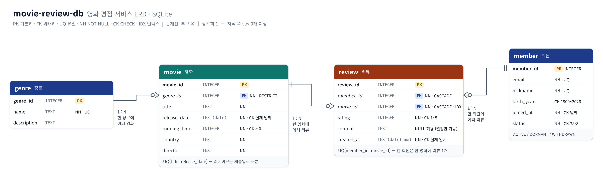

# 설계 문서

## 1. 도메인

영화 평점 서비스입니다. 회원이 영화에 별점(1~5)과 짧은 리뷰를 남기고, 서비스는 평균 별점·랭킹·장르별 통계를 보여줍니다.
이 서비스에서 실제로 필요한 질문을 먼저 정하고, 그 질문에 답할 수 있도록 테이블을 설계했습니다.

| 서비스에서 나올 질문 | 쿼리 |
| --- | --- |
| 요즘 나온 영화는? 긴 영화는? 제목 검색은? | Q01, Q03, Q04 |
| 최근 리뷰를 누가 어떤 영화에 남겼나? | Q05 |
| 평균 별점 TOP 5, 장르별 통계, 월별 추이는? | Q09, Q10, Q12 |
| 리뷰를 안 쓰는 회원은? 오래 활동이 없는 회원은? | Q07, Q15 |
| 탈퇴 회원 정리는? | Q16 |

쿼리는 모두 17개이며, 과제가 요구한 필수 15개와 추가 2개(Q12 월별 추이, Q14 장르별 1위)로 구분합니다. 구분 기준은 [`sql/03_queries.sql`](../sql/03_queries.sql) 머리 주석에 있습니다.

## 2. 테이블을 왜 4개로 나눴나



엑셀처럼 한 시트에 "리뷰 한 줄 = 회원 정보 + 영화 정보 + 별점" 을 모두 적는다고 가정해 보면 문제가 바로 보입니다.

| 회원 닉네임 | 회원 이메일 | 영화 제목 | 장르 | 감독 | 개봉일 | 별점 |
| --- | --- | --- | --- | --- | --- | --- |
| 팝콘요정 | popcorn@… | 기생충 | 드라마 | 봉준호 | 2019-05-30 | 5 |
| 시네필 | cinephile@… | 기생충 | 드라마 | 봉준호 | 2019-05-30 | 5 |
| 팝콘요정 | popcorn@… | 인터스텔라 | SF | 크리스토퍼 놀란 | 2014-11-06 | 5 |

- **중복**: 기생충 리뷰가 7개면 감독·개봉일이 7번 반복됩니다.
- **수정 이상**: 회원이 이메일을 바꾸면 그 회원의 리뷰 행을 모두 찾아 고쳐야 하고, 하나라도 놓치면 같은 회원의 이메일이 두 개가 됩니다.
- **삽입 이상**: 아직 리뷰가 없는 새 영화나 새 회원은 넣을 자리가 없습니다(별점 칸을 비워야 함).
- **삭제 이상**: 어떤 영화의 마지막 리뷰를 지우면 그 영화의 정보도 함께 사라집니다.

그래서 **한 가지 대상(엔티티)은 한 테이블에 한 번만** 저장하고, 나머지는 키로 연결했습니다.

| 테이블 | 무엇을 저장하나 | 한 행의 의미 | 행 수 |
| --- | --- | --- | ---: |
| `genre` | 장르 목록 | 장르 하나 | 10 |
| `member` | 회원 | 회원 한 명 | 15 |
| `movie` | 영화 | 영화 한 편 (장르 하나에 속함) | 22 |
| `review` | 리뷰 | 회원 한 명이 영화 한 편에 남긴 평가 하나 | 78 |

| 작업 | 한 시트 방식 수정 행 수 | 분리 구조 수정 행 수 |
| --- | ---: | ---: |
| 최다 리뷰 회원 스릴러킹의 이메일 변경 | 10 | `member` 1 |
| 기생충의 감독·개봉일 변경 | 7 | `movie` 1 |

시드 기준 영화 정보를 저장하는 횟수도 리뷰 행마다 반복하는 78회에서 영화별 22회로 줄어, 정보 수정과 누락 확인이 쉬워집니다.

이제 회원 이메일은 `member` 에 한 번만 있으므로 한 곳만 고치면 되고, 리뷰가 없는 영화도 `movie` 에 존재할 수 있습니다(Q08 의 0건 영화 2편).

### 정규화 확인

| 테이블 | 1NF(원자값, 반복 그룹 없음) | 2NF(단일 컬럼 PK 라 부분 종속 없음) | 3NF(PK 가 아닌 컬럼끼리 종속 없음) |
| --- | --- | --- | --- |
| `genre` | 이름·설명을 각각 한 값으로 저장합니다 | `genre_id` 전체에 종속됩니다 | 이름·설명 사이에 별도 종속이 없습니다 |
| `member` | 이메일·닉네임 등을 각각 한 값으로 저장합니다 | `member_id` 전체에 종속됩니다 | 이메일·닉네임은 후보키이며 다른 일반 속성 사이에 종속이 없습니다 |
| `movie` | 대표 장르 하나와 영화 속성을 저장합니다 | `movie_id` 전체에 종속됩니다 | 장르명은 `movie` 에 두지 않고 `genre` 로 분리합니다 |
| `review` | 별점·내용·작성일을 각각 한 값으로 저장합니다 | `review_id` 전체에 종속됩니다 | 회원·영화 정보는 저장하지 않고 FK 로 연결합니다 |

한 시트 방식에서는 리뷰 키 → 영화 키 → 영화 정보로 이행 종속이 생겨 3NF 를 위반합니다.

## 3. 관계 (1:N)

| 관계 | FK | 도메인 의미 | 데이터 예시 | FK NULL 허용 여부 | ON DELETE 동작과 그 영향 |
| --- | --- | --- | --- | --- | --- |
| genre 1 : N movie | `movie.genre_id → genre.genre_id` | 한 장르에 여러 영화가 속한다 | 액션 → 범죄도시, 어벤져스: 엔드게임, 탑건: 매버릭, 부산행 | 불가 (`NOT NULL`) | `RESTRICT`: 영화 4편이 참조하는 액션 장르 삭제는 거부됩니다(B09). `ON UPDATE CASCADE` 로 장르 키 변경은 영화에 반영됩니다. |
| member 1 : N review | `review.member_id → member.member_id` | 한 회원이 여러 리뷰를 쓴다 | 스릴러킹 → 리뷰 10개 (Q11) | 불가 (`NOT NULL`) | `CASCADE`: 탈퇴 회원 삭제 시 리뷰도 함께 삭제되어 78 → 76개가 됩니다(Q16). |
| movie 1 : N review | `review.movie_id → movie.movie_id` | 한 영화에 여러 리뷰가 달린다 | 기생충 → 리뷰 7개 (Q08) | 불가 (`NOT NULL`) | `CASCADE`: 시드에서 기생충 삭제 시 리뷰 7개도 삭제되어 78 → 71개가 됩니다. |

모든 FK 가 `NOT NULL` 이므로, 부모가 없는 리뷰를 FK 의 NULL 값으로 우회해 저장할 수도 없습니다.

"N 쪽" 테이블이 "1 쪽" 테이블의 PK 를 FK 컬럼으로 들고 있습니다. 리뷰 한 행은 자기가 어느 회원·어느 영화에 속하는지 알지만, 회원 행은 자기 리뷰 목록을 들고 있지 않습니다. 목록은 JOIN 으로 그때그때 모읍니다.

`review` 는 동시에 **회원과 영화의 N:M 관계를 풀어주는 연결 테이블**입니다. 한 회원은 여러 영화를, 한 영화는 여러 회원이 평가하는데, 관계형 DB 는 N:M 을 직접 표현할 수 없어서 두 개의 1:N 으로 나눕니다. 연결 테이블이 "별점·내용·작성일" 이라는 자기 데이터를 갖고 있어 독립된 테이블로 의미가 있습니다.

### 단순화한 부분

실제 영화는 장르가 여러 개입니다(기생충 = 드라마 + 스릴러). 이번 과제에서는 **대표 장르 하나**만 두어 genre–movie 를 1:N 으로 단순화했습니다. 여러 장르를 지원하려면 `movie_genre(movie_id, genre_id, PRIMARY KEY(movie_id, genre_id))` 연결 테이블을 추가하고 `movie.genre_id` 를 없애면 됩니다.

## 4. 컬럼 타입 선택

SQLite 의 타입은 다섯 가지 저장 클래스(NULL, INTEGER, REAL, TEXT, BLOB)이고, 컬럼 타입은 "선호하는 저장 방식(affinity)" 입니다. 그 안에서 의미에 맞게 골랐습니다.

| 컬럼 | 타입 | 이유 |
| --- | --- | --- |
| `*_id` | PK 는 `INTEGER PRIMARY KEY`, FK 는 `INTEGER NOT NULL` | PK 는 rowid 의 별칭이며 번호를 자동 부여합니다. 시드 PK 최대값은 genre/member/movie/review 순서로 10/15/22/78이지만, 증가를 고려해 최대 2^63−1까지 지원합니다(MySQL: `INT` 또는 규모에 따라 `BIGINT`). |
| `rating` | `INTEGER` + `CHECK (1~5)` | 시드도 1~5이며 정수 별점을 저장하고 평균은 `AVG()` 로 계산합니다. 이 범위는 1바이트 이내입니다(값 1은 아래 예외). MySQL 이라면 `TINYINT` 를 씁니다. |
| `running_time` | `INTEGER` (분) | 시드는 94~181분입니다. 운영 범위를 1~600분으로 가정하면 최대 2바이트 범위이며, MySQL 이라면 `SMALLINT` 를 씁니다. 현재 CHECK 는 `> 0` 만 강제하고 600분 상한은 가정입니다. |
| `birth_year` | `INTEGER` | 연도만 저장하며 시드는 1978~2004입니다. CHECK 범위 1900~2026의 값은 2바이트로 저장됩니다(MySQL: `SMALLINT`). |
| `release_date`, `joined_at` | `TEXT` `'YYYY-MM-DD'` | SQLite 에는 DATE 타입이 없다. ISO-8601 문자열은 **사전순 = 날짜순**이라 `>=` 비교·정렬이 그대로 되고, `date()`/`strftime()` 함수가 이 형식을 이해한다 |
| `created_at` | `TEXT` `'YYYY-MM-DD HH:MM:SS'` | 같은 이유. 같은 날 여러 리뷰의 순서를 위해 시각까지 저장 |
| `name`, `title`, `email`, `content` | `TEXT` | 길이 제한이 없는 문자열. (MySQL 이라면 `VARCHAR(n)` 으로 길이를 제한하는 것이 일반적) |
| `status` | `TEXT` + `CHECK IN (...)` | 값이 3개로 고정되고 거의 바뀌지 않아 별도 테이블 대신 CHECK 로 허용값을 제한. 상태가 늘어나거나 상태별 설명이 필요해지면 `member_status` 테이블로 분리 |

SQLite 의 일반 INTEGER 값은 크기에 따라 1·2·3·4·6·8바이트로 저장됩니다(0·1은 전용 코드로 값 저장 공간이 0바이트입니다). `INTEGER PRIMARY KEY` 는 별도의 가변 길이 rowid 로 저장되므로 이 값 크기 규칙과 구분합니다.

### PK: 대체키(INTEGER) vs 자연키

모든 PK 는 `INTEGER PRIMARY KEY` 로, rowid 별칭을 직접 탐색하므로 조회·조인 시 별도 PK 인덱스를 거치는 비용을 줄입니다.

| 테이블 | 대체키를 선택한 이유 |
| --- | --- |
| `genre` | 장르명은 바뀔 수 있어 `UNIQUE` 로 중복만 막고, 참조에는 `genre_id` 를 씁니다 |
| `member` | email·nickname 은 바뀔 수 있어 `UNIQUE` 로만 보장하고, 안정적인 `member_id` 를 PK 로 씁니다 |
| `movie` | `(title, release_date)` 는 두 컬럼 문자열이라 FK 로 들고 다니기 무거워 `UNIQUE` 로 두고 `movie_id` 로 연결합니다 |
| `review` | `(member_id, movie_id)` 의 중복은 `UNIQUE` 로 막고, 리뷰 한 건은 단일 `review_id` 로 조회·수정합니다 |

## 5. 제약조건

| 제약 | 적용 위치 | 막는 상황 |
| --- | --- | --- |
| `PRIMARY KEY` | 모든 테이블 | 같은 행을 가리키는 id 가 두 개 생기는 것 |
| `NOT NULL` | 이메일, 닉네임, 제목, 별점, 날짜, 모든 FK | 필수 정보가 빠진 행. FK 가 NULL 이면 "어느 영화의 리뷰인지 모르는" 행이 됨 |
| `UNIQUE` | `genre.name`, `member.email`, `member.nickname`, `movie(title, release_date)`, `review(member_id, movie_id)` | 같은 이메일로 두 번 가입, 한 회원이 같은 영화에 리뷰를 두 번 다는 것 |
| `CHECK` | 별점 1~5, 러닝타임 > 0, 출생연도 범위, 상태 3종, 날짜·일시 형식 | 범위를 벗어난 값, 존재하지 않는 날짜 |
| `FOREIGN KEY` | `movie.genre_id`, `review.member_id`, `review.movie_id` | 없는 부모를 가리키는 고아 행 |

### FK 삭제 정책

| FK | 정책 | ON UPDATE 정책 | 참조 도메인 | 이유 |
| --- | --- | --- | --- | --- |
| `movie.genre_id` | `ON DELETE RESTRICT` | `CASCADE` | `movie.genre_id → genre.genre_id`: 존재하는 정수 키, NULL 불가. 시드 부모 1~10, 실제 FK 1~9 | 참조 중인 장르 삭제를 막습니다(B09). 장르 키 변경은 영화에도 반영합니다 |
| `review.member_id` | `ON DELETE CASCADE` | 미지정 = `NO ACTION` | `review.member_id → member.member_id`: 존재하는 정수 키, NULL 불가. 시드 부모·실제 FK 모두 1~15 | 회원 삭제 시 리뷰도 삭제합니다(Q16: 78 → 76). 참조 중인 회원 키 변경은 거부합니다. 통계 보존이 필요하면 `status = 'WITHDRAWN'` 으로 표시하는 소프트 삭제를 고려합니다 |
| `review.movie_id` | `ON DELETE CASCADE` | 미지정 = `NO ACTION` | `review.movie_id → movie.movie_id`: 존재하는 정수 키, NULL 불가. 시드 부모 1~22, 실제 FK 1~21 | 영화 삭제 시 리뷰도 삭제하고, 참조 중인 영화 키 변경은 거부합니다 |

범위는 시드에서 확인한 값이며 FK 의 상·하한 제약은 아닙니다. `rating` 은 FK 가 아니며 `CHECK (rating BETWEEN 1 AND 5)` 로 1~5 도메인을 제한합니다(시드 최솟값 1, 최댓값 5).

### SQLite 에서 주의한 점 두 가지

1. **FK 검사는 기본으로 꺼져 있다.** `PRAGMA foreign_keys = ON;` 을 연결(세션)마다 실행해야 합니다. 모든 SQL 파일 첫 줄에 넣었고, DB Browser·DBeaver 로 실행할 때도 이 줄을 먼저 실행해야 합니다. 꺼진 상태에서 고아 행이 들어가는 모습은 B13 에서 재현했습니다.
2. **CHECK 는 NULL 을 통과시킨다.** 날짜 검사를 처음에는 `CHECK (date(joined_at) = joined_at)` 로 썼는데, `date('2024-13-01')` 은 NULL 이 되고 `NULL = '2024-13-01'` 도 NULL 이라 CHECK 를 통과했습니다(CHECK 는 결과가 거짓일 때만 막음). `=` 대신 NULL 도 하나의 값처럼 비교하는 `IS` 로 바꿔 해결했습니다. 이 문제는 테스트(`test_check_unique_not_null`)를 작성하다 발견했고, B10 에 재현 쿼리를 남겼습니다.

## 6. 인덱스

### 자동으로 생기는 인덱스

| 인덱스 | 원인 | 쓸 수 있는 조회 |
| --- | --- | --- |
| rowid (각 테이블 PK) | `INTEGER PRIMARY KEY` | `WHERE member_id = ?`, JOIN 의 "1 쪽" 찾기 |
| `sqlite_autoindex_member_1/2` | `UNIQUE(email)`, `UNIQUE(nickname)` | 이메일·닉네임으로 찾기 |
| `sqlite_autoindex_review_1` | `UNIQUE(member_id, movie_id)` | `member_id` 로 찾기 (복합 인덱스의 **앞 컬럼**이므로) |

### 직접 만든 인덱스: `idx_review_movie_id ON review(movie_id)` (Q17)

- **왜 이 컬럼인가**: `review.movie_id` 는 영화별 리뷰 수·평균·랭킹(Q08~Q14)의 JOIN·GROUP BY 에 가장 자주 쓰입니다. 서비스에서 가장 많이 열리는 화면이 "영화 상세 페이지의 리뷰 목록" 이기도 합니다.
- **왜 자동 인덱스로 안 되나**: SQLite 는 FK 컬럼에 인덱스를 자동으로 만들지 않습니다. `UNIQUE(member_id, movie_id)` 인덱스는 `member_id` 순으로 정렬돼 있어서, 전화번호부가 성으로 정렬돼 있으면 이름만으로는 찾을 수 없듯 `movie_id` 만으로는 쓸 수 없습니다.
- **효과 (실행 계획)**

```text
생성 전   `--SCAN review                                              ← 78행 전부 확인
생성 후   `--SEARCH review USING INDEX idx_review_movie_id (movie_id=?) ← 해당 영화 행만 바로 찾음
JOIN     |--SCAN m
         `--SEARCH r USING INDEX idx_review_movie_id (movie_id=?)     ← 영화마다 리뷰를 인덱스로 찾음
```

- **비용**: 인덱스는 별도 B-tree 라 저장 공간을 쓰고, INSERT·DELETE 때마다 함께 갱신해야 합니다. 서비스에서 쓰기가 가장 잦다고 보는 `review` 는 인덱스를 늘릴수록 쓰기 비용도 늘어납니다. 현재 78행은 SCAN 으로도 처리할 양이 작으므로, 명시적으로 만드는 인덱스는 Q17의 1개만 유지합니다.

추가 후보의 우선순위는 다음과 같습니다. 시드 직후 임시 DB 에 현재 인덱스를 만든 상태를 기준으로 후보별 `EXPLAIN QUERY PLAN` 을 비교했습니다(2순위는 기존 인덱스를 대체했습니다).

1. **`review(created_at)` — Q02·Q05**: 최근순 `ORDER BY created_at DESC LIMIT` 에서 `SCAN` 이 `SCAN … USING INDEX` 로 바뀌고 정렬용 `USE TEMP B-TREE FOR ORDER BY` 가 사라졌습니다. Q02의 별점 필터는 남습니다. 리뷰 INSERT·DELETE 와 작성일 변경 때 갱신 비용이 듭니다.
2. **`review(movie_id, rating)` — Q09·Q14**: 평균 계산의 `SEARCH r USING INDEX` 가 `SEARCH r USING COVERING INDEX (movie_id=?)` 로 바뀌어 별점을 인덱스에서 읽습니다. 기존 인덱스와 겹치므로 대체할 때만 고려합니다. 키가 넓어지고 리뷰 INSERT·DELETE 외에 별점 변경도 갱신 비용이 듭니다.
3. **`movie(genre_id)` — Q06·Q10**: Q10의 `SEARCH m USING AUTOMATIC COVERING INDEX` 가 상설 인덱스의 `SEARCH m USING COVERING INDEX` 로 바뀌어 임시 자동 인덱스를 대신합니다. Q06은 `SCAN m` 과 정렬이 그대로여서 효과를 확인하지 못했습니다. 영화 INSERT·DELETE 와 장르 변경 때 갱신 비용이 듭니다.
4. **`movie(release_date)` — Q01**: `SCAN movie` 가 `SEARCH movie USING INDEX (release_date>?)` 로 바뀌고 정렬용 임시 B-tree 가 사라졌습니다. 영화 INSERT·DELETE 와 개봉일 변경 때 갱신 비용이 듭니다.

## 7. 쿼리 작성 원칙

- **명시적 JOIN + 별칭**: `FROM review AS r INNER JOIN member AS mb ON …` 처럼 조인 조건을 `ON` 에 써서 필터 조건(`WHERE`)과 구분했습니다.
- **`COUNT(컬럼)` 과 `COUNT(*)` 구분**: LEFT JOIN 에서 짝이 없는 행은 리뷰 컬럼이 NULL 입니다. `COUNT(r.review_id)` 는 NULL 을 세지 않아 0 이 되고, `COUNT(*)` 는 행 자체를 세서 1 이 됩니다(Q08).
- **`WHERE` 와 `HAVING` 구분**: 묶기 전 행을 거르는 조건은 `WHERE`, 묶은 뒤 그룹을 거르는 조건(리뷰 3개 이상)은 `HAVING` (Q09).
- **정렬 동점 처리**: `ORDER BY avg_rating DESC, review_count DESC, title` 처럼 끝까지 순서를 정해 실행할 때마다 결과 순서가 같도록 했습니다(재현 가능한 결과 파일을 위해 필요).
- **표준 SQL 우선**: `CASE WHEN`, `COALESCE`, `EXISTS`, CTE(`WITH`) 등 표준 문법을 쓰고, DB 전용 문법은 주석으로 표시했습니다.

### SQLite 전용 문법과 다른 DB 대응

| 사용처 | SQLite | MySQL | PostgreSQL |
| --- | --- | --- | --- |
| FK 활성화 | `PRAGMA foreign_keys = ON` | 기본 활성 (InnoDB) | 기본 활성 |
| 월 추출 (Q12, R01) | `strftime('%Y-%m', created_at)` | `DATE_FORMAT(created_at, '%Y-%m')` | `to_char(created_at, 'YYYY-MM')` |
| 날짜 형식 CHECK | `CHECK (date(x, '+0 days') IS x)` | `DATE` 타입 사용 | `DATE` 타입 사용 |
| 자동 증가 PK | `INTEGER PRIMARY KEY` | `INT AUTO_INCREMENT PRIMARY KEY` | `INTEGER GENERATED ALWAYS AS IDENTITY` |
| 실행 계획 (Q17, B05) | `EXPLAIN QUERY PLAN` | `EXPLAIN` | `EXPLAIN` |

## 8. 재현 방법

`scripts/run_all.py` 가 빈 DB 를 만들고 `01_schema.sql` → `02_seed.sql` 을 실행한 뒤, 쿼리 파일마다 새 DB 에서 블록(`-- @Qnn`)을 차례로 실행해 결과를 `results/` 에 씁니다.
보너스 파일을 새 DB 에서 실행하는 이유는 03 의 UPDATE/DELETE 결과가 보너스 결과에 섞이지 않게 하기 위해서입니다.

- `python scripts/run_all.py --check` 는 SQL 을 다시 실행해 `results/` 와 비교합니다. SQL 을 고치고 결과 파일을 갱신하지 않으면 실패합니다(CI 에서 실행).
- 실행 계획 문구는 SQLite 버전마다 조금씩 달라서(Q17, B05) 비교에서 제외합니다.
- `tests/test_sql.py` 는 테이블 수, PK, FK, 행 수, 제약조건 동작, 쿼리 범주별 개수를 자동으로 검사합니다. 쿼리는 과제 필수 15개(기본 4 · 조인 4 · 집계 3 · 서브쿼리 1 · 수정/삭제 2 · 인덱스 1)와 추가 2개(Q12 · Q14)로 나뉘며, 필수 15개의 범주별 개수가 요구와 정확히 같은지는 `test_required_fifteen_match_categories` 가 따로 검사합니다.
